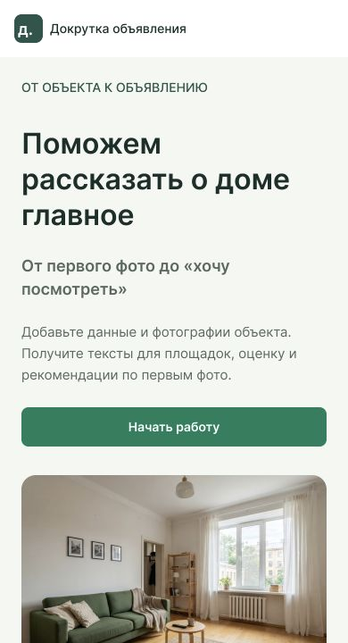
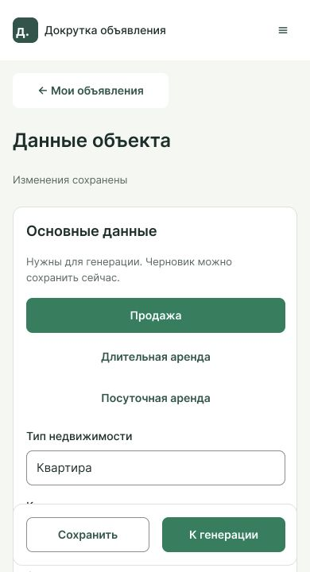
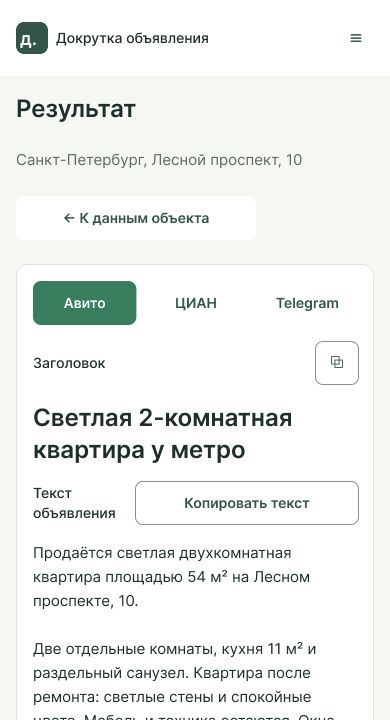

# Докрутка объявления — UX/UI

Редактируемые макеты, состояния интерфейса и кликабельные прототипы веб-сервиса. Снимок от 26 октября 2026 года.

- [Макет в Figma](https://www.figma.com/design/sRJKjBDE8UctvKwacFGybg)
- [Основной прототип](https://www.figma.com/proto/sRJKjBDE8UctvKwacFGybg?node-id=18-170&starting-point-node-id=18-170)
- [Мобильный прототип](https://www.figma.com/proto/sRJKjBDE8UctvKwacFGybg?node-id=20-897&starting-point-node-id=20-897)
- [Мобильный вход](https://www.figma.com/proto/sRJKjBDE8UctvKwacFGybg?node-id=326-3957&starting-point-node-id=20-897)
- [Индекс состояний](https://www.figma.com/design/sRJKjBDE8UctvKwacFGybg?node-id=45-183)

На главной «Начать работу» открывает вход. Переход к регистрации и обратно доступен внутри формы.

## Файлы

- `advertising-ux-ui.fig` — редактируемая резервная копия всех страниц. Для открытия: Figma → Import → Import from computer. Комментарии и история версий в копию не входят.
- `links.json` — ссылки на экраны и состояния по задачам № 10–24.
- `previews/` — превью верхней части мобильных экранов шириной 390 px.

## Структура макета

- 00 — обзор, визуальная система и компоненты.
- 01 — экраны и состояния.
- 02 — связанные прототипы.

## Превью

## Задачи и макеты

| Задача | Раздел | Макеты и состояния |
| --- | --- | --- |
| [№ 10](https://github.com/ta4ilka69/fine-tuning-of-advertising/issues/10) | Общая UI-основа | [listDesktop](https://www.figma.com/design/sRJKjBDE8UctvKwacFGybg?node-id=9-6) · [editorTablet768](https://www.figma.com/design/sRJKjBDE8UctvKwacFGybg?node-id=160-2330) · [photoGallery320](https://www.figma.com/design/sRJKjBDE8UctvKwacFGybg?node-id=233-1379) |
| [№ 11](https://github.com/ta4ilka69/fine-tuning-of-advertising/issues/11) | Клиент API и сессия | [authLoginExpired](https://www.figma.com/design/sRJKjBDE8UctvKwacFGybg?node-id=14-1944) · [authLoginNetwork](https://www.figma.com/design/sRJKjBDE8UctvKwacFGybg?node-id=14-1860) · [adminSettingsDenied](https://www.figma.com/design/sRJKjBDE8UctvKwacFGybg?node-id=14-2582) |
| [№ 12](https://github.com/ta4ilka69/fine-tuning-of-advertising/issues/12) | Вход | [loginDesktop](https://www.figma.com/design/sRJKjBDE8UctvKwacFGybg?node-id=10-133) · [authLoginInvalid](https://www.figma.com/design/sRJKjBDE8UctvKwacFGybg?node-id=14-1830) · [authLoginSubmitting](https://www.figma.com/design/sRJKjBDE8UctvKwacFGybg?node-id=14-1890) · [authLoginPasswordVisible](https://www.figma.com/design/sRJKjBDE8UctvKwacFGybg?node-id=14-1917) · [prototypeLoginMobile](https://www.figma.com/design/sRJKjBDE8UctvKwacFGybg?node-id=326-3957) |
| [№ 13](https://github.com/ta4ilka69/fine-tuning-of-advertising/issues/13) | Регистрация | [registerDesktop](https://www.figma.com/design/sRJKjBDE8UctvKwacFGybg?node-id=10-163) · [authRegisterFieldErrors](https://www.figma.com/design/sRJKjBDE8UctvKwacFGybg?node-id=14-1974) · [authRegisterTaken](https://www.figma.com/design/sRJKjBDE8UctvKwacFGybg?node-id=14-2005) · [authRegisterSubmitting](https://www.figma.com/design/sRJKjBDE8UctvKwacFGybg?node-id=14-2036) · [authRegisterNetwork](https://www.figma.com/design/sRJKjBDE8UctvKwacFGybg?node-id=14-2064) |
| [№ 14](https://github.com/ta4ilka69/fine-tuning-of-advertising/issues/14) | Список объявлений | [listDesktop](https://www.figma.com/design/sRJKjBDE8UctvKwacFGybg?node-id=9-6) · [listEmpty](https://www.figma.com/design/sRJKjBDE8UctvKwacFGybg?node-id=12-379) · [listLoading](https://www.figma.com/design/sRJKjBDE8UctvKwacFGybg?node-id=12-504) · [listError](https://www.figma.com/design/sRJKjBDE8UctvKwacFGybg?node-id=12-541) · [listMobile](https://www.figma.com/design/sRJKjBDE8UctvKwacFGybg?node-id=10-416) |
| [№ 15](https://github.com/ta4ilka69/fine-tuning-of-advertising/issues/15) | Поиск и фильтры | [listFiltered](https://www.figma.com/design/sRJKjBDE8UctvKwacFGybg?node-id=12-453) · [listNoResults](https://www.figma.com/design/sRJKjBDE8UctvKwacFGybg?node-id=12-415) |
| [№ 16](https://github.com/ta4ilka69/fine-tuning-of-advertising/issues/16) | Создание объявления | [editorSaleEmpty](https://www.figma.com/design/sRJKjBDE8UctvKwacFGybg?node-id=12-577) · [editorLongRentFilled](https://www.figma.com/design/sRJKjBDE8UctvKwacFGybg?node-id=12-671) · [editorShortRentFilled](https://www.figma.com/design/sRJKjBDE8UctvKwacFGybg?node-id=12-811) · [editorRoomFilled](https://www.figma.com/design/sRJKjBDE8UctvKwacFGybg?node-id=12-951) · [editorHouseFilled](https://www.figma.com/design/sRJKjBDE8UctvKwacFGybg?node-id=12-1063) · [editorApartmentsFilled](https://www.figma.com/design/sRJKjBDE8UctvKwacFGybg?node-id=12-1176) · [editorTablet768](https://www.figma.com/design/sRJKjBDE8UctvKwacFGybg?node-id=160-2330) |
| [№ 17](https://github.com/ta4ilka69/fine-tuning-of-advertising/issues/17) | Фотографии | [editorPhotoErrors](https://www.figma.com/design/sRJKjBDE8UctvKwacFGybg?node-id=12-2351) · [photoUploadErrors](https://www.figma.com/design/sRJKjBDE8UctvKwacFGybg?node-id=14-2758) · [photoGalleryReady](https://www.figma.com/design/sRJKjBDE8UctvKwacFGybg?node-id=67-3630) · [photoGalleryEmpty](https://www.figma.com/design/sRJKjBDE8UctvKwacFGybg?node-id=120-1163) · [photoGalleryProcessing](https://www.figma.com/design/sRJKjBDE8UctvKwacFGybg?node-id=214-1369) · [photoGalleryFailed](https://www.figma.com/design/sRJKjBDE8UctvKwacFGybg?node-id=218-1374) · [photoGallery20](https://www.figma.com/design/sRJKjBDE8UctvKwacFGybg?node-id=79-3680) · [photoGallery320](https://www.figma.com/design/sRJKjBDE8UctvKwacFGybg?node-id=233-1379) |
| [№ 18](https://github.com/ta4ilka69/fine-tuning-of-advertising/issues/18) | Редактирование | [editorSaved](https://www.figma.com/design/sRJKjBDE8UctvKwacFGybg?node-id=12-1885) · [editorSaveError](https://www.figma.com/design/sRJKjBDE8UctvKwacFGybg?node-id=12-1999) · [editorWarning](https://www.figma.com/design/sRJKjBDE8UctvKwacFGybg?node-id=12-1659) · [editorConflict](https://www.figma.com/design/sRJKjBDE8UctvKwacFGybg?node-id=12-2116) · [editorLocked](https://www.figma.com/design/sRJKjBDE8UctvKwacFGybg?node-id=12-2233) · [leaveUnsaved](https://www.figma.com/design/sRJKjBDE8UctvKwacFGybg?node-id=14-2740) · [listingConflictConfirm](https://www.figma.com/design/sRJKjBDE8UctvKwacFGybg?node-id=152-1171) · [listingLocalCopy](https://www.figma.com/design/sRJKjBDE8UctvKwacFGybg?node-id=153-1174) |
| [№ 19](https://github.com/ta4ilka69/fine-tuning-of-advertising/issues/19) | Удаление | [deleteDefault](https://www.figma.com/design/sRJKjBDE8UctvKwacFGybg?node-id=14-2694) · [deleteDraft](https://www.figma.com/design/sRJKjBDE8UctvKwacFGybg?node-id=14-2702) · [deleteDeleting](https://www.figma.com/design/sRJKjBDE8UctvKwacFGybg?node-id=14-2710) · [deleteError](https://www.figma.com/design/sRJKjBDE8UctvKwacFGybg?node-id=14-2718) · [deleteBusy](https://www.figma.com/design/sRJKjBDE8UctvKwacFGybg?node-id=14-2729) · [deleteMobile](https://www.figma.com/design/sRJKjBDE8UctvKwacFGybg?node-id=14-2750) |
| [№ 20](https://github.com/ta4ilka69/fine-tuning-of-advertising/issues/20) | Запуск генерации | [generationQueued](https://www.figma.com/design/sRJKjBDE8UctvKwacFGybg?node-id=13-2385) · [generationRunning](https://www.figma.com/design/sRJKjBDE8UctvKwacFGybg?node-id=13-2404) · [generationFailed](https://www.figma.com/design/sRJKjBDE8UctvKwacFGybg?node-id=13-2423) · [generationRateLimit](https://www.figma.com/design/sRJKjBDE8UctvKwacFGybg?node-id=13-2441) · [generationNoChannels](https://www.figma.com/design/sRJKjBDE8UctvKwacFGybg?node-id=13-2459) · [generationInsufficient](https://www.figma.com/design/sRJKjBDE8UctvKwacFGybg?node-id=13-2477) · [generationPhotosPending](https://www.figma.com/design/sRJKjBDE8UctvKwacFGybg?node-id=13-2495) |
| [№ 21](https://github.com/ta4ilka69/fine-tuning-of-advertising/issues/21) | Результат: тексты | [resultDesktop](https://www.figma.com/design/sRJKjBDE8UctvKwacFGybg?node-id=9-198) · [resultCian](https://www.figma.com/design/sRJKjBDE8UctvKwacFGybg?node-id=13-2229) · [resultTelegram](https://www.figma.com/design/sRJKjBDE8UctvKwacFGybg?node-id=13-2307) · [resultCopied](https://www.figma.com/design/sRJKjBDE8UctvKwacFGybg?node-id=13-1935) · [resultCopyError](https://www.figma.com/design/sRJKjBDE8UctvKwacFGybg?node-id=13-2016) |
| [№ 22](https://github.com/ta4ilka69/fine-tuning-of-advertising/issues/22) | Результат: оценка и фото | [resultStale](https://www.figma.com/design/sRJKjBDE8UctvKwacFGybg?node-id=13-1584) · [resultRetryQueued](https://www.figma.com/design/sRJKjBDE8UctvKwacFGybg?node-id=13-1668) · [resultRetryRunning](https://www.figma.com/design/sRJKjBDE8UctvKwacFGybg?node-id=13-1749) · [resultRetryFailed](https://www.figma.com/design/sRJKjBDE8UctvKwacFGybg?node-id=13-1830) · [resultOnePhoto](https://www.figma.com/design/sRJKjBDE8UctvKwacFGybg?node-id=13-2100) · [resultTwoPhotos](https://www.figma.com/design/sRJKjBDE8UctvKwacFGybg?node-id=13-2160) |
| [№ 23](https://github.com/ta4ilka69/fine-tuning-of-advertising/issues/23) | Список площадок | [adminListDesktop](https://www.figma.com/design/sRJKjBDE8UctvKwacFGybg?node-id=10-194) · [adminListEmpty](https://www.figma.com/design/sRJKjBDE8UctvKwacFGybg?node-id=14-2095) · [adminListLoading](https://www.figma.com/design/sRJKjBDE8UctvKwacFGybg?node-id=14-2120) · [adminListError](https://www.figma.com/design/sRJKjBDE8UctvKwacFGybg?node-id=14-2142) · [adminCreateDesktop](https://www.figma.com/design/sRJKjBDE8UctvKwacFGybg?node-id=10-328) · [adminSettingsDenied](https://www.figma.com/design/sRJKjBDE8UctvKwacFGybg?node-id=14-2582) |
| [№ 24](https://github.com/ta4ilka69/fine-tuning-of-advertising/issues/24) | Настройки площадки | [adminSettingsDesktop](https://www.figma.com/design/sRJKjBDE8UctvKwacFGybg?node-id=10-240) · [adminSettingsErrors](https://www.figma.com/design/sRJKjBDE8UctvKwacFGybg?node-id=14-2167) · [adminSettingsSaving](https://www.figma.com/design/sRJKjBDE8UctvKwacFGybg?node-id=14-2247) · [adminSettingsSaved](https://www.figma.com/design/sRJKjBDE8UctvKwacFGybg?node-id=14-2327) · [adminSettingsError](https://www.figma.com/design/sRJKjBDE8UctvKwacFGybg?node-id=14-2410) · [adminSettingsConflict](https://www.figma.com/design/sRJKjBDE8UctvKwacFGybg?node-id=14-2496) · [adminSettingsRuleAdded](https://www.figma.com/design/sRJKjBDE8UctvKwacFGybg?node-id=14-2601) · [adminConflictConfirm](https://www.figma.com/design/sRJKjBDE8UctvKwacFGybg?node-id=141-1165) · [adminLocalCopy](https://www.figma.com/design/sRJKjBDE8UctvKwacFGybg?node-id=151-1168) |
